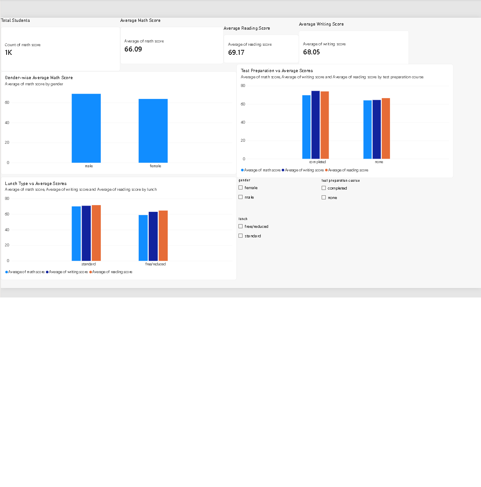

# SWYNEX – Final Data Analytics Project

## Student Performance Analysis and Interactive Dashboard

### 1. Project Overview

This project was completed as part of the Data Analyst Internship at SWYNEX Technologies. It combines data cleaning, exploratory data analysis, data visualization, and interactive dashboard development into a complete analytics case study.

### 2. Problem Statement

The objective of this project is to analyze student academic performance and understand how factors such as gender, lunch type, parental education, and test preparation are associated with examination scores.

### 3. Dataset Information

- Dataset: Student Performance in Exams
- Source: Kaggle
- Total Records: 1,000
- Total Columns: 8
- File Format: CSV

The dataset contains gender, race/ethnicity, parental level of education, lunch type, test preparation course, math score, reading score, and writing score.

### 4. Tools and Technologies

- Python
- Pandas
- Matplotlib
- Google Colab
- Microsoft Power BI Desktop
- GitHub

### 5. Data Cleaning and Preparation

- Imported the original dataset using Pandas.
- Examined the dataset structure and data types.
- Checked for missing values.
- Checked for duplicate records.
- Verified data consistency.
- Exported the cleaned dataset for further analysis.

The dataset contained no missing values or duplicate records.

### 6. Exploratory Data Analysis

Exploratory Data Analysis was performed to identify patterns and relationships in student performance.

The analysis included:

- Descriptive statistics
- Average subject scores
- Gender-wise performance
- Test preparation comparison
- Lunch type comparison
- Parental education analysis

### 7. Interactive Power BI Dashboard

The dashboard includes:

**Key Performance Indicators (KPIs)**

| KPI | Value |
|---|---:|
| Total Students | 1,000 |
| Average Math Score | 66.09 |
| Average Reading Score | 69.17 |
| Average Writing Score | 68.05 |

**Visualizations**

- Gender-wise Average Math Score
- Test Preparation vs Average Scores
- Lunch Type vs Average Scores

**Interactive Filters**

- Gender
- Lunch Type
- Test Preparation Course

### 8. Dashboard Preview

### 9. Key Business Insights

- Male students achieved a higher average math score than female students.
- Female students achieved higher average reading and writing scores.
- Students who completed test preparation achieved higher average scores across all three subjects.
- Students with standard lunch achieved higher average scores than students with free/reduced lunch.
- Interactive filters allow users to explore performance across different student groups.

### 10. Recommendations

- Encourage participation in test preparation programs.
- Provide additional academic support to students with lower performance.
- Explore the relationship between socioeconomic factors and academic outcomes.
- Use interactive dashboards to monitor student performance and support educational decisions.

These findings represent associations and do not establish causation.

### 11. Project Files

- StudentsPerformance.csv – Original dataset
- Cleaned_StudentsPerformance.csv – Cleaned dataset
- SWYNEX_Data_Cleaning_.ipynb – Data cleaning notebook
- SWYNEX_Exploratory_Data_Analysis.ipynb – EDA notebook
- SWYNEX_Student_Performance_Dashboard.pbix – Power BI dashboard
- SWYNEX_Dashboard_Screenshot.png – Dashboard preview

### 12. How to Use

- Download the CSV files and Jupyter notebooks.
- Open the notebooks in Google Colab or Jupyter Notebook.
- Download the PBIX file and open it in Power BI Desktop.
- Use the interactive slicers to explore student performance.

### 13. Conclusion

This project demonstrates an end-to-end data analytics workflow, from raw data preparation to interactive dashboard development and actionable insights.

Through this internship project, I developed practical skills in Python, data cleaning, exploratory data analysis, Power BI, data visualization, and analytical reporting.

### Internship Details

**Organization:** SWYNEX Technologies

**Domain:** Data Analyst Internship

**Task:** Task 4 – Final Data Analytics Project

Thank you for reviewing my project!

